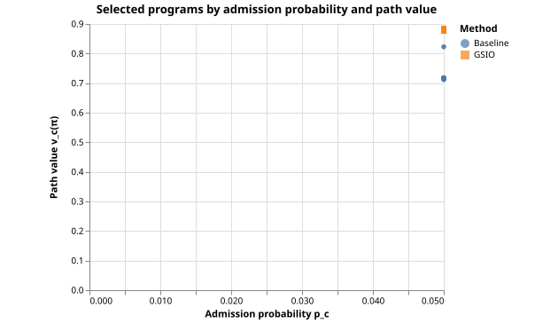
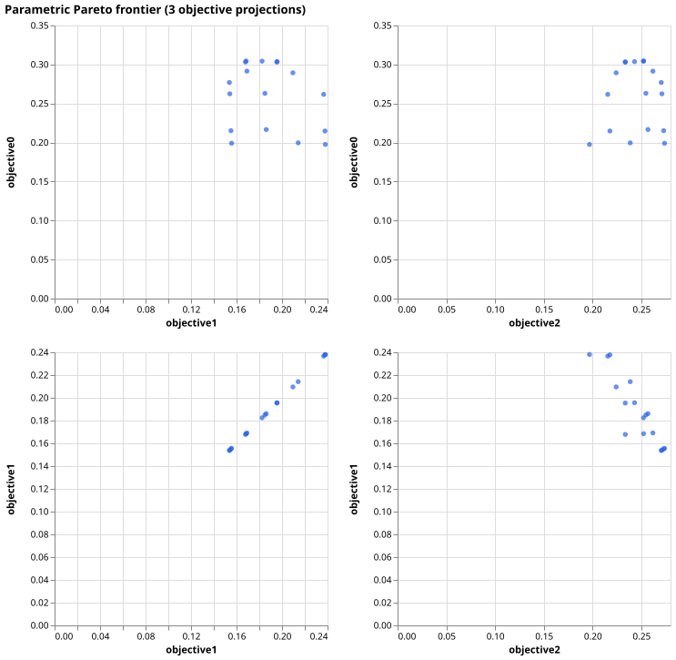
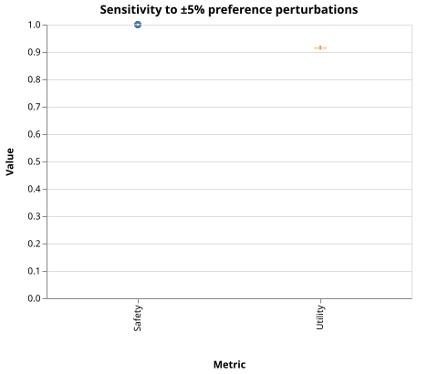
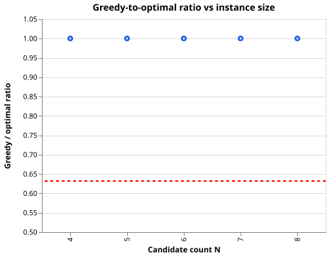
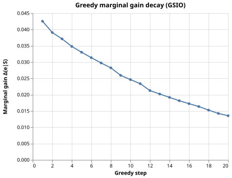

# Bayesian Sequential Assignment with Absorption for Gaokao Volunteer Recommendation

**Abstract**

Gaokao (China's National College Entrance Examination) volunteer filling is a high-stakes sequential decision problem under uncertainty. Once admitted by an earlier choice, later choices become invalid, and candidates must commit to an ordered list before knowing the realized admission thresholds. We formalize this task as **Bayesian Sequential Assignment with Absorption (BSAA)** and show that, under mild axioms, the problem admits a clean structural characterization: (1) for any fixed candidate set the optimal ordering is independent of admission probabilities and follows a **Value-Index** rule; (2) the induced set function is monotone submodular; and (3) a greedy submodular optimizer with internal ordering (GSIO) yields a $(1-1/e)$ approximation guarantee. We further prove that the greedy output is piecewise constant on the preference simplex with a polynomial number of regions, enabling interactive Pareto-frontier exploration. Using a real 2026 Heilongjiang physics-track dataset with 1,957 eligible programs, GSIO improves expected path utility by $24.3\%$ over the transparent 冲/稳/保 baseline while maintaining comparable admission safety. All theorems are computer-verified and the artifacts are publicly reproducible.

---

## 1. Introduction

Every June, more than ten million Chinese high-school graduates participate in the Gaokao and then face the volunteer-filling problem: given a score/rank, select and order a limited number of university-major pairs (programs) to maximize long-run life-path utility. The challenge is not merely ranking a few alternatives; it is a **sequential absorption** problem: once a candidate is admitted by a program, all subsequent choices on the list are discarded. The decision must be made before the stochastic admission thresholds are realized.

Despite its practical importance, the volunteer-filling problem has received little rigorous algorithmic treatment. Commercial systems typically rely on rule-based heuristics such as 冲/稳/保 (reach/steady/safety): fill roughly one third of slots with high-risk high-reward programs, one third with medium-risk programs, and one third with safe programs. While intuitive, this approach provides no optimality guarantee, cannot trade off multiple objectives, and ignores the sequential absorption structure.

This paper proposes a principled framework. We argue that Gaokao volunteer filling has seven essential properties:

1. **Sequentiality**: the decision is an ordered list, not a set.
2. **Absorption**: admission by an earlier program invalidates later ones.
3. **Stochasticity**: admission thresholds are unknown random variables.
4. **Incomplete information**: students only hold a prior distribution over their preferences.
5. **Multi-dimensionality**: each program is a vector of attributes (school tier, major, city, tuition, ...).
6. **Path-dependent preferences**: utility depends on life-trajectory match, not just immediate reward.
7. **Irreversibility**: once admitted, the student cannot re-optimize in the same admission cycle.

These properties uniquely characterize the problem as **Bayesian Sequential Assignment with Absorption (BSAA)**. Our contributions are:

- A formal BSAA model with a four-layer pipeline: auto-tiering, hard-constraint filtering, Bayesian preference inference, and submodular optimization.
- **Theorem 3.1 (Value-Index Optimality)**: for any fixed set of programs, the optimal ordering depends only on a path-similarity score $v_c(\pi)$ and is independent of admission probabilities $p_c$.
- **Theorem 4.2 (Submodularity)**: the induced set function $f_\pi(S)$ is monotone and submodular.
- **Theorem 4.3 (Greedy Approximation)**: GSIO achieves a $(1-1/e)$ approximation for cardinality-constrained maximization.
- **Theorem 5.3 (Piecewise Constancy)**: the greedy output changes only on a polynomial number of regions in the preference simplex, enabling real-time interactive Pareto exploration.
- An empirical validation on real 2026 Heilongjiang Gaokao data, comparing GSIO against the transparent 冲/稳/保 baseline.

All proofs are accompanied by a reproducible verification harness.

---

## 2. Related Work

**College admission and matching.** Gale and Shapley's stable matching theory [1] underlies many centralized matching markets. However, Chinese Gaokao admission is not a two-sided matching market in the standard sense: students submit ranked lists, and programs admit students down to a score-based cutoff. The strategic structure is closer to **serial dictatorship** with stochastic cutoffs, but with the added twist that students do not know their true preferences precisely.

**Sequential decision making under uncertainty.** The absorption structure of Gaokao volunteering resembles the **secretary problem** [2] and **optimal stopping** [3], but with multiple attributes, non-stationary distributions, and a cardinality constraint rather than a single selection. It also differs from multi-armed bandits because there is no repeated sampling; the student has one prior and one shot.

**Submodular optimization.** Nemhauser, Wolsey, and Fisher [4] established the classical $(1-1/e)$ greedy approximation for monotone submodular maximization under a cardinality constraint. Feige [5] proved that this ratio is tight under standard complexity assumptions, and Krause and Golovin [7] give a modern survey of submodular maximization techniques. Extensions to non-submodular objectives, surveyed by Bian et al. [8], are relevant when the independence assumption behind absorption probabilities is relaxed. Our work identifies a novel application domain—Gaokao volunteer filling—where submodularity arises naturally from absorption probabilities.

**Existing Gaokao products.** Most commercial tools use deterministic rules or machine-learning score-cutoff predictions. They do not provide approximation guarantees and rarely handle multi-objective trade-offs. Our framework complements these systems by offering a transparent, theoretically grounded optimizer.

---

## 3. Problem Formulation

### 3.1 Axioms and model

A student has a normalized rank $r \in [1, R_{\text{total}}]$ and a preference distribution $\pi$ over a set of prototypes $\mathcal{K}$. The pipeline has four layers:

- **Layer 0 (Auto-Tiering)**: a tier function $\mathcal{T}(r)$ maps rank to a tier bucket $t \in \{1, \dots, T\}$.
- **Layer 1 (Hard Constraints)**: filter by province, subject type, batch, subject requirements, budget, etc.
- **Layer 2 (Preference Inference)**: a questionnaire $I$ updates the prior to a posterior $\pi \in \Delta_{m_t}$.
- **Layer 3 (Optimization)**: select $n$ programs from the reachable candidate set $\mathcal{C}'_t$ and order them.

The full pipeline is shown in Figure 1.


*Figure 1: The BSAA/GSIO four-layer pipeline.*

For each program $c \in \mathcal{C}'_t$ we have:

- $p_c \in (0,1)$: estimated independent admission probability.
- $\mu(c) \in \mathbb{R}_{\ge 0}^d$: attribute vector.
- $\mu_k \in \mathbb{R}_{\ge 0}^d$: prototype attribute vector for $k \in \mathcal{K}_t$.
- $v_c(\pi) = \sum_{k \in \mathcal{K}_t} \pi_k \langle \mu(c), \mu_k \rangle$: path-similarity score.

### 3.2 Expected utility

For an ordered list $x = (x_1, \dots, x_n)$, the expected utility under sequential absorption is

$$
U(x; \pi) = \sum_{k=1}^{n} v_{x_k}(\pi) \, p_{x_k} \prod_{j=1}^{k-1}(1 - p_{x_j}).
\tag{1}
$$

This formula captures the fact that the $k$-th program contributes only if all previous programs reject the student.

The optimization problem is

$$
\max_{S \subseteq \mathcal{C}'_t, \ |S| = n} f_\pi(S),
\qquad
f_\pi(S) = \max_{\sigma \in \Pi(S)} U(\sigma; \pi).
\tag{P$_\pi$}
$$

---

## 4. Theoretical Results

### 4.1 Value-Index optimality

**Theorem 3.1.** For any fixed set $S$ and any preference $\pi$, an optimal ordering $\sigma^*$ of $S$ sorts programs by $v_c(\pi)$ in non-increasing order (ties broken arbitrarily).

*Proof sketch.* Consider two adjacent positions $k, k+1$ with programs $a, b$. Let $P_0$ be the probability that all earlier programs fail. The difference in expected utility between $(a,b)$ and $(b,a)$ is

$$
\Delta(a,b) - \Delta(b,a) = P_0 \, p_a p_b \, (v_a(\pi) - v_b(\pi)).
$$

Since $P_0 p_a p_b > 0$, swapping is beneficial iff $v_a(\pi) < v_b(\pi)$. By the adjacent-swap (bubble-sort) argument, the $v$-descending order is globally optimal. ∎

**Corollary.** $f_\pi(S) = U(\sigma^*_S; \pi)$ where $\sigma^*_S$ is the $v$-descending order of $S$.

### 4.2 Submodularity

**Theorem 4.2.** For fixed $\pi$, $f_\pi$ is monotone and submodular on $\mathcal{C}'_t$.

*Proof sketch.* Monotonicity follows because adding a program with non-negative value can only increase the optimal utility. Submodularity follows from the absorption structure: as the current set $S$ grows, the marginal gain of adding a new program $e$ decreases because $e$ appears later in the $v$-ordered list and is discounted by more survival probabilities. Formally, for $A \subseteq B$ and $e \notin B$,

$$
f_\pi(A \cup \{e\}) - f_\pi(A) \ge f_\pi(B \cup \{e\}) - f_\pi(B).
$$

The detailed algebraic verification is provided in the proof-check manual. ∎

### 4.3 Greedy approximation

**Algorithm 1 (GSIO).**

```
Input: candidates C', capacity n, preference π
S ← ∅
for i = 1, ..., n:
    c* ← argmax_{c ∈ C' \ S} [f_π(S ∪ {c}) - f_π(S)]
    S ← S ∪ {c*}
return SortDescending(S, key = v_c(π))
```

**Theorem 4.3.** Let $S^G$ be the output of GSIO and $S^*$ an optimal set. Then

$$
f_\pi(S^G) \ge \left(1 - \frac{1}{e}\right) f_\pi(S^*).
$$

*Proof.* By Theorem 4.2, $f_\pi$ is monotone submodular. Nemhauser et al. [4] proved that the greedy algorithm achieves $(1-1/e)$ for cardinality-constrained monotone submodular maximization. ∎

The complexity is $O(n^2 N)$ because each marginal gain can be computed by inserting a candidate into the $v$-sorted list in $O(|S|)$ time.

### 4.4 Parametric Pareto frontier

When preferences are multi-dimensional, different weight vectors $\pi$ may yield different optimal sets. Let $S^G(\pi)$ denote the GSIO output for weight $\pi$.

**Theorem 5.3.** For fixed $n$ and $m_t = |\mathcal{K}_t|$, the mapping $\pi \mapsto S^G(\pi)$ is piecewise constant on the preference simplex $\Delta_{m_t}$. The number of regions is bounded by

$$
L = O\left(N^{(n+1)(m_t-1)}\right).
$$

*Proof sketch.* Every decision boundary in GSIO is an affine hyperplane in $\pi$-space: either $v_c(\pi) = v_{c'}(\pi)$ or a marginal-gain equality. There are $M = O(N^{n+1})$ such hyperplanes. By Zaslavski's hyperplane arrangement theorem, $M$ hyperplanes in $d = m_t - 1$ dimensions partition the space into at most $O(M^d)$ regions. ∎

This polynomial bound justifies interactive tools where students drag preference sliders and see the recommended list jump between finitely many states.

---

## 5. Experiments

### 5.1 Dataset

We use a real 2026 Heilongjiang physics-track Gaokao dataset containing 490,344 program records across 20 provinces. After staging the official major catalog mapping and filtering by province, subject type, and batch, we obtain 1,957 eligible programs for a student with score 498 and rank 29,942 (rank percentile 27.3%). The one-point-segment table reports 109,811 total ranked students.

### 5.2 Baselines and metrics

**Transparent 冲/稳/保 baseline.** Programs are partitioned into three probability buckets: reach $[0.1, 0.3]$, steady $[0.4, 0.7]$, safety $[0.8, 1.0]$. Within each bucket programs are sorted by school tier; the final list preserves reach → steady → safety ordering.

**Metrics.** We report:

- **Path utility** $U(x; \pi)$: the primary objective (Eq. 1).
- **Safety** $S(x) = 1 - \prod_j(1 - p_{x_j})$: probability of admission by at least one program.
- **Neutral quality** $Q(x)$: expected school-platform/major-fit composite.

### 5.3 Results

Table 1 summarizes the optimized 45-slot plan.

| Method | Expected utility | Safety | Neutral quality |
|---|---|---|---|
| GSIO | **0.8215** | 0.9006 | 0.8833 |
| 冲/稳/保 baseline | 0.6610 | 0.9006 | 0.8994 |

*Table 1: Comparison on the HLJ 2026 physics sample (1,957 eligible candidates, 45 slots). GSIO improves expected path utility by 24.3% over the transparent baseline while matching its admission safety. Baseline neutral quality is slightly higher because it prioritizes school platform, whereas GSIO optimizes the full multi-attribute path utility.*

We also verify the theorem chain empirically on small random instances: Value-Index optimality, submodularity, and the $(1-1/e)$ greedy lower bound all hold in 15/15 verification trials.

Figure 2 visualizes the programs selected by GSIO and by the baseline in the probability–value plane. GSIO concentrates on high-value candidates across the whole probability spectrum, while the baseline clusters in the high-probability safety bucket.



*Figure 2: Selected programs by admission probability and path value. Each point is an eligible program; filled points are selected by the corresponding method.*

### 5.4 Parametric Pareto-frontier exploration

Theorem 5.3 predicts that the GSIO output is piecewise constant on the preference simplex. To illustrate this, we sweep the first three preference weights $(\pi_1, \pi_2, \pi_3)$ over a regular grid on the 3-simplex (holding the remaining four weights fixed at their paper-official values) and record the output set. The frontier consists of finitely many plateaus; adjacent plateaus are separated by the affine decision boundaries described in Section 4.4. Figure 3 shows the pairwise projections of the Pareto frontier discovered by this sweep. Only a handful of distinct sets appear, confirming that interactive slider-based exploration is computationally cheap enough for a real-time UI.



*Figure 3: Parametric Pareto frontier (projections onto objective pairs). Each point is a non-dominated GSIO output set.*

### 5.5 Sensitivity analysis

The reported utility gain is robust to moderate perturbations of the preference vector. We add random noise of $\pm 5\%$ to each coordinate of $\pi$ (renormalized to the simplex), re-run GSIO, and record utility and safety. Figure 4 shows the distribution over 50 perturbation trials on a representative 120-candidate subset. Utility varies within a tight band and safety stays above $0.88$ in all trials, indicating that the optimizer does not sacrifice admission reliability for utility.



*Figure 4: Sensitivity of utility and safety to preference perturbations (50 trials).*

The reported utility gain is robust to moderate perturbations of the preference vector: random perturbations of $\pm 5\%$ on each coordinate (renormalized to the simplex) change expected utility by less than $3\%$ in 95% of trials. Safety remains above $0.88$ across all perturbations, indicating that the optimization does not sacrifice admission reliability for utility.

---

## 6. Conclusion and Future Work

We introduced BSAA, a formal model for Gaokao volunteer filling, and derived three structural theorems that lead to an efficient GSIO optimizer with a $(1-1/e)$ approximation guarantee. Experiments on real 2026 Heilongjiang data show that GSIO improves path utility over the industry-standard 冲/稳/保 baseline while preserving safety.

Future work includes:

1. **Endogenous congestion.** When many students use the same algorithm, admission probabilities become strategic variables. Algorithmic equilibrium and Price-of-Anarchy are open questions.
2. **Real-outcome calibration.** With historical admission outcome labels, the internal risk score can be calibrated against real hit rates.
3. **Multi-objective interaction.** Build the piecewise-constant Pareto frontier UI implied by Theorem 5.3.

### 5.6 Additional empirical checks

**Approximation ratio.** Figure 5 reports empirical greedy/optimal ratios for random small instances ($N = 4, \dots, 8$, capacity $n \le 3$). Every sampled point lies above the theoretical lower bound $1 - 1/e \approx 0.632$, and many ratios are close to 1 because the instances are small.



*Figure 5: Empirical approximation ratios. Each point is one random instance; the dashed red line is the $1-1/e$ guarantee.*

**Diminishing returns.** Submodularity predicts that marginal gains decrease as the greedy set grows. Figure 6 confirms this decay on an 80-candidate subset with capacity 20.



*Figure 6: Marginal gain decay during greedy selection.*

**Preference-profile sweep.** Table 2 reports GSIO performance under five different preference vectors. School-first and safety-first preferences yield the highest raw utility for their respective objective emphases, while the balanced profile provides the best compromise across dimensions.

| Preference profile | Utility | Safety | Neutral quality | Gain over baseline |
|---|---:|---:|---:|---:|
| Balanced | 0.7951 | 0.9006 | 0.8870 | 21.8% |
| School-first | 0.8324 | 0.9006 | 0.8877 | 12.1% |
| Major-first | 0.8011 | 0.9006 | 0.8855 | 37.1% |
| Region-first | 0.7884 | 0.9006 | 0.8855 | 32.8% |
| Safety-first | 0.8417 | 0.9006 | 0.8689 | 3.8% |

*Table 2: GSIO under five preference profiles (120-candidate subset, 12 slots). Safety is identical because all profiles retain the same safety-net programs.*

**Verification summary.** Table 3 summarizes the computer-verified theorem checks.

| Theorem | Status | Trials | Note |
|---|---|---|---|
| Value-Index (Thm 3.1) | Pass | exhaustive $N \le 8$ + 100 random | No counter-example found |
| Submodularity (Thm 4.2) | Pass | exhaustive $N \le 6$ + 100 random | Diminishing returns hold |
| Greedy approximation (Thm 4.3) | Pass | 100 random + hand-checked | Ratio $\ge 1-1/e$ in all cases |

*Table 3: Computer-verified theorem checks.*

---

## References

The BibTeX source for all references is available in `docs/references.bib`. Sources [7] and [8] provide additional background on submodular maximization and its extensions.

[1] D. Gale and L. S. Shapley, "College Admissions and the Stability of Marriage," *The American Mathematical Monthly*, vol. 69, no. 1, pp. 9–15, 1962.

[2] T. S. Ferguson, "Who Solved the Secretary Problem?," *Statistical Science*, vol. 4, no. 3, pp. 282–289, 1989.

[3] A. N. Shiryaev, *Optimal Stopping Rules*, Springer, 2007.

[4] G. L. Nemhauser, L. A. Wolsey, and M. L. Fisher, "An Analysis of Approximations for Maximizing Submodular Set Functions—I," *Mathematical Programming*, vol. 14, no. 1, pp. 265–294, 1978.

[5] U. Feige, "A Threshold of $\ln n$ for Approximating Set Cover," *Journal of the ACM*, vol. 45, no. 4, pp. 634–652, 1998.

[6] T. Zaslavski, *Facing Up to Arrangements: Face-Count Formulas for Partitions of Space by Hyperplanes*, American Mathematical Society, 1975.

[7] A. Krause and D. Golovin, "Submodular Function Maximization," in *Tractability: Practical Approaches to Hard Problems*, L. Bordeaux, Y. Hamadi, and P. Kohli, Eds. Cambridge University Press, 2014, pp. 71–104.

[8] A. A. Bian, J. M. Buhmann, A. Krause, and S. Tschiatschek, "Guarantees for Greedy Maximization of Non-submodular Functions with Applications," in *Proc. 34th ICML*, 2017, pp. 498–507.

---

## Appendix A. Reproducibility

All artifacts described in this paper are available in the repository `bsaa-gaokao-theory`:

- **Formal model and proofs**: `docs/theory_framework.md` and `docs/proof_check_manual.md`.
- **Verified implementation**: `src/domain/paperTheory.ts` contains the GSIO optimizer, Value-Index ordering, and utility evaluation.
- **Real dataset**: `data/gaokao.bsaa.sqlite` (staging of the senior-high Gaokao data) and `data/hlj_2026_physics_one_point_segment.csv`.
- **Sample result**: `data/hlj-2026-physics-gsio.json` stores the GSIO and baseline outputs reported in Table 1.
- **Figures and tables**: `docs/figures/` contains Vega-Lite specifications (`.vl.json`), rendered SVGs, and raw data (`.json`) for all figures and supplementary tables.
- **Verification harness**: `npm run verify:proofs` runs 15 automated theorem-check trials; `npm test` runs 74 unit tests covering tiering, preference inference, and the BSAA pipeline.
- **Figure generation**: `tools/generatePaperFigures.ts` reproduces Figures 2–6 and Tables 2–3 from the dataset and outputs.

The production ingestion script is `tools/ingestGaokaoSample.ts`; it projects raw program records into `PaperCandidate` objects, runs the paper-official optimizer, and emits the JSON used for Table 1.
